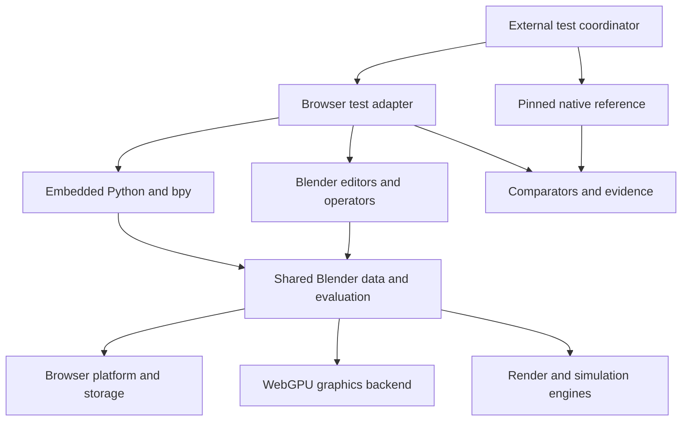

# Blender browser parity programme

## Objective and implementation direction

Use an existing source-derived Blender browser port as the application foundation. Retain Blender's scene data, dependency graph, operators, Python API, editors and file semantics wherever possible. Implement browser platform and GPU adaptations around that shared core. The existing Three.js modeller remains a separately identified experiment and its tests do not establish compatibility of the source-derived application.

The delivery units are facets of one application. They are ownership, dependency and acceptance boundaries, not independent scene implementations or microservices. Source reuse is the default; rebuilding an upstream subsystem requires a concrete portability or performance reason and differential tests.

The full target remains the existing `blender/blender@94363991e7dcf39e2d70614aa002ab6f67764a5d`, which identifies itself as Blender 5.4.0 alpha. Freeze that exact commit for the programme. Moving to a newer commit is an explicit migration, including test and feature deltas. Completing an older candidate baseline does not complete this target.

This document specifies the programme. It does not claim that the facets are implemented or that Blender's full test corpus has executed. Current machine-readable scope and evidence live in `compatibility/facets.json`, `compatibility/facet-inventory.json`, `compatibility/browser-ports.lock.json` and the separate `browser-port-evidence`, `numeric-diagnostics-evidence`, `candidate-data-evidence`, `candidate-io-evidence` and `browser-source-evidence` branches.

## 1. Candidate baselines

| Candidate | Exact source | Native reference | Role |
|---|---|---|---|
| gessa-ai/blender-web | `0e02e84b2bc5d9b27a6dc6e275443292f781fbad` | `fbe6228777e7d9afefcd61a413844e790ae75db7`, Blender 5.2 | Provisional primary candidate for source reuse; its patch, platform, Python and parity infrastructure must be reproduced and audited. |
| gessa v0.1.1 release | `cc22090b88da63cc617d48b218f4945175928844` | Same declared 5.2 reference | Available immutable binary for initial independent runtime qualification. Its results do not validate candidate HEAD. |
| HeyPuter/blender-wasm | `e73ddff77079dc96b2a7af6e7b843a7ecfbbb11a`; engine fork `fe16888d9e1e5eee3070535a221dd9ae2d671a77` | Official merge base `594182577fb6209179847d3f36b2b196cd7f9c8c`, requiring port-diff review; fork identifies as 5.3 alpha | Independent candidate and possible GPU/platform implementation donor. |
| Blended product target | `94363991e7dcf39e2d70614aa002ab6f67764a5d` | Exact matching desktop build | Final feature/test contract. Both candidates require a version migration. |

All candidate references are pinned in the lock file. Select one canonical application after reproduction; importing a fix from the other candidate requires a reviewed source diff and target-specific regression tests. Do not merge two engines, two undo stacks or incompatible Python data models.

### Required qualification before adoption

1. Reconstruct the exact source and toolchain. For gessa HEAD, use `patches/canonical` and its hash-bound snapshot. Its numbered patch series is historical development evidence and is not the clean replay authority.
2. Build the unmodified native reference with the intended feature set. Preserve the binary, configuration, dependency versions and source hash.
3. Build the browser candidate and record all features disabled or replaced. Puter's published cache files disable `WITH_TESTS` and `WITH_GTESTS`; a separate test configuration is required.
4. Execute selected original unit/Python tests in the browser, then a real `.blend` load/edit/save workflow. Record software-GPU and hardware-GPU results separately.
5. Verify source-to-binary correspondence, fixture availability, licence notices and reproducibility. A release download is an input to qualification, not evidence that the current source builds.
6. Compare candidates on retained functionality, observed failures, patch maintenance cost and deployed operation. README claims and upstream smoke script exit codes are insufficient acceptance evidence.

The initial CI probe executes the entire unmodified `bl_pyapi_mathutils.py` and `bl_pyapi_bmesh.py` modules from the candidate's exact upstream pin. It adapts the unittest invocation boundary and preserves test assertions. This is selected candidate qualification only: a complete test-enabled native build, hardware matrix, production deployment and 5.4 migration are still separate gates.

The [source-build entry point and diagnostic workflow](BROWSER_SOURCE_BUILD.md)
now make the next steps executable: reconstruct and compile the pinned port,
qualify that exact new artifact, and compare separate numerical observations
without changing the acceptance tests.

### Observed baseline, 22 October 2026

Independent qualification has now produced the following results:

| Check | Observed result | Meaning |
|---|---|---|
| Canonical source replay | Digest-bound patch applies cleanly to the pristine official 5.2 reference; 305 changed paths | Source reconstruction is demonstrated. A source build and release-binary correspondence are not yet demonstrated. |
| Official native 5.2.0 | 180/180 mathutils and 12/12 BMesh tests pass | The downloaded official archive matches its published SHA-256 and the runtime reports the expected `fbe6228777e7` build hash. |
| gessa v0.1.1 browser artifact | 179/180 mathutils and 11/12 BMesh top-level tests pass | Two observed divergences relative to the passing native baseline; the candidate qualification stays failed. |
| Fixed data cohort | Native and browser each pass all 48 ID/RNA/property cases | All five NumPy cases execute. Browser qualification remains blocked by its unknown build hash. |
| Browser binary identity | Version 5.2.0, build hash `Unknown` | The exact downloaded artifact is hash-verified, but its source correspondence remains unverified. |
| GPU profile | Independent adapter probe observes SwiftShader | Diagnostic software-GPU execution only. It does not validate the engine's selected hardware adapter or rendering parity. |
| Product target | Incomplete inventory and zero verified 5.4 target obligations | These selected 5.2 tests are not a full-application percentage or evidence of the required version migration. |

The failing tests are `VectorTesting.test_orthogonal` and `TestBMeshOperators.test_spin_screw_complex`. The first differs from its expected angle by about `7.55e-8`; the second differs in summed edge lengths by about `8.43e-5`. Both exceed their unchanged upstream criteria. The BMesh subtest failure interrupts assignment of a coordinate set, causing a subsequent parent assertion to fail. Therefore the receipt contains three failure events but only two failed top-level tests. It does not establish an independent third geometry defect.

The relevant mathutils/BMesh CPU implementation files are unchanged in the independently replayed canonical source. Separate diagnostics and actual WebAssembly kernel experiments now reproduce both observed numerical differences:

- The pinned Emscripten `acosf` small-input branch returns the lower adjacent float for 136 of the original orthogonal test's 144 nonzero inputs. Rebuilding its ordinary and pthread libc variants with the corrected branch matches the native angle bits for all 144 observations.
- Eigen's scalar inverse reproduces all 49 browser screw vertex positions exactly. Selecting Eigen's existing SIMD inverse for the single matrix translation unit reproduces all 49 native vertex positions and the observed edge lengths without changing BMesh or the upstream assertions.

These are isolated arithmetic observations within two parent tests, not additional acceptance-test counts. The [hash-bound patchset and actual Wasm regression runner](../patches/browser-numerics/README.md) preserve the original and candidate results. They target the recorded official Linux x64 native reference; other architectures need separate evidence. The source builder applies the patches, rebuilds the affected libc variants in an isolated cache and records both source identities. The complete rebuilt engine must still pass the unchanged 192-case cohort before either parent failure can be closed. The released artifact's unknown source correspondence remains independent of these numerical findings.

The next fixed cohort covers all 48 native-discovered cases in the unchanged ID management, RNA accessor and ID property modules. Native and browser executions pass all 48, including all five conditional NumPy cases, with no missing outcomes or recorded browser runtime errors. The [candidate manifest](../compatibility/candidate-suites/data-5.2.json) makes those cases mandatory: a negative control with NumPy cases missing correctly reports 43 observed passes, 48 required cases and a failed gate. The reporting adapter calls the base unittest identity method so an upstream `id` data property does not corrupt discovery. This changes the reporting boundary only. The [browser receipt](https://github.com/596050/blended/blob/2951e05572921fe502ab716409a7b7b1f77d0a7c/57ae857fc2d1945a262c3638b12f9b8c4884bdbd/39843162244/candidate-data-browser/qualification.json) retains the unknown-build-hash blocker. These selected 5.2 cases do not close the scene-data or Python facets.

The separate [blend-file cohort](../compatibility/candidate-suites/blendio-5.2.json) preserves all four methods of `bl_blendfile_io.py`, its unchanged helper and its original `__main__` invocation. CPython monitoring observes setup, body and teardown start/return/unwind events without replacing any tested callable. The native adapter passes all four and retrieves six generated files with matching in-engine hashes. The IO workflow runs the same original driver in the browser, retrieves its actual files through the exported filesystem, and reopens the four current `.blend` files from both producers in the same verified native reader. This final-bundle exchange is a separate obligation, not four additional upstream method passes. It does not preserve every overwritten intermediate version or establish persistent linked-library coverage.

Receipts and read-only triage are under `compatibility/evidence/`. The [first browser run](https://github.com/596050/blended/actions/runs/39833848371) and its [case-level receipt](https://github.com/596050/blended/blob/browser-port-evidence/4ebc34ca4c436b287d1e704cf94df7ad710a0c6e/39833848371/qualification.json) preserve the original failure. The workflow runs the exact native release and browser artifact separately; its evidence job retains both without converting a native pass into a browser pass.

## 2. Application architecture

Keep a shared Blender runtime in WebAssembly with its normal internal subsystem boundaries. The porting work concentrates at the browser host, GPU backend, dependency builds, filesystem and asynchronous execution seams.



The external coordinator can use native Python/Node, CTest, image tools and subprocesses. Upstream host-side test drivers do not all have to run inside browser Python. Preserve assertions and expected results while adapting how a driver starts Blender, supplies fixtures and retrieves output.

Use workers and incremental loading where supported, but keep data ownership explicit. Avoid duplicating scene truth in a JavaScript view model. High-level editor commands should continue to invoke Blender operators; rendering and evaluation should consume the same evaluated scene. Shared memory, event-loop suspension, filesystem calls and GPU readback need documented thread and lifetime contracts.

## 3. Thirty acceptance facets

The full source/test/fixture patterns and dependency graph are in `compatibility/facets.json`. Patterns support discovery and ownership. They are not runtime enumeration and do not create passing tests.

| Facet | Scope | Representative upstream evidence | Additional closure requirement |
|---|---|---|---|
| `foundation` | Build, memory, mathematics, containers | BLI and allocator native tests | Exact source/toolchain reproduction, WebAssembly execution and numeric policy |
| `platform` | GHOST, windowing, threads, files, events | File/path/task tests and input simulation | Browser focus, permissions, OPFS, workers, isolation, reload and failures |
| `python_api` | CPython, bpy, RNA, bundled modules, extensions | `bl_pyapi_*`, `bl_rna_*`, module/add-on loading | Real scripts, callbacks, extension dependencies and error semantics |
| `scene_data` | IDs, collections, relationships, attributes | BKE, ID and view-layer sources | Stable ownership, references, copying, deletion and evaluated data |
| `blend_io` | `.blend`, versioning, linking, overrides, recovery | `bl_blendfile_*`, loader and undo tests | Desktop/browser/desktop round trips and recovery |
| `depsgraph` | Evaluation, invalidation, instances | Dependency graph and relationship tests | Correct updates after edit, time change and linked-data change |
| `object_transforms` | Selection, transforms, snapping, history | Object scripts, transform and undo UI tests | Modal keyboard/pointer interaction and cancel/redo |
| `mesh_edit` | BMesh and edit-mode operations | BMesh, bevel, boolean, operators, validation | Correct topology, attributes and actual editing workflows |
| `modifiers` | Modifier evaluation and stacks | Modifier/deform scripts and fixtures | Every required modifier enabled, stack interactions and save/reload |
| `curves_text_hair` | Curves, text, lattice, hair, points | Curve/lattice native tests and conversion scripts | Attributes, evaluation, conversion and domain-specific editing |
| `geometry_nodes` | Nodes, fields, sockets, zones, caches | `geo_node_test.py`, `bl_node_*`, node fixtures | Per-node inventory, combinations, caches, editing and serialization |
| `sculpt` | Brushes, masks, dyntopo, remesh, multires | Sculpt/paint native and Python tests | Stroke semantics, undo, high-density interaction and pen input |
| `uv` | Seams, unwrap, islands, packing | Operator/modelling and UI test families | Explicit UV acceptance where upstream coverage is incomplete |
| `painting` | Texture, vertex and weight painting | Dedicated brush/undo and weight scripts | Image/weight outputs, pressure, undo and saved assets |
| `gpu_backend` | Buffers, textures, shaders, compute, sync | GPU and shader-tool tests, `bl_pyapi_gpu.py` | Equivalent WebGPU resource, query, readback and device-loss behaviour |
| `workbench` | Solid viewport, overlays, picking | Workbench, overlay and screenshot drivers | Correct visible geometry plus selection and interaction state |
| `materials_color` | Shading graphs, textures, image/color | Node, imbuf and OCIO tests | Consistent color configuration and material semantics across engines |
| `eevee` | EEVEE engine | `eevee_render_tests.py` and render fixtures | Engine-specific lighting/material/pass outputs and viewport behaviour |
| `cycles_cpu` | Cycles CPU, baking, denoising | In-tree Cycles tests and render driver | Matching feature configuration, fixtures, samples and comparison policy |
| `cycles_gpu` | Cycles on browser GPU | Cycles suite plus GPU contracts | Actual browser GPU engine with hardware evidence; CPU passes stay separate |
| `animation_rigging` | Keys, actions, NLA, drivers, armatures, IK | Animrig, animation, constraint and rigging tests | Evaluated poses/frames, editing and saved animation |
| `simulation` | Physics, fluids, cloth, caches, volumes | Physics scripts, node simulations, volume tests | Fixed initial conditions, evaluated trajectories and cache round trips |
| `grease_pencil` | 2D strokes, layers, effects, animation | Grease Pencil native/Python/paint tests | Data, rendering, input, animation and file workflows |
| `format_io` | Interchange and image formats | Native IO, OBJ/STL/USD/Alembic and image tests | Format-specific materials, transforms, animation and external assets |
| `compositing` | Nodes, passes, masks, outputs | Compositor render and file-output drivers | CPU/GPU configurations, linked passes and written outputs |
| `video_audio` | Sequencer, codecs, sound | Sequencer, FFmpeg and sound tests | Browser playback, seeking, sync and export |
| `tracking` | Tracking, camera solve, masks | Tracking/libmv and compositor fixtures | Tracked points, reprojection, solved cameras and UI workflow |
| `assets` | Asset libraries, catalogs, linking | Asset-system, pose/brush asset and drop tests | Browser paths, networking, offline use and persistent identity |
| `ui_workflows` | Editors, workspaces, menus, keymaps, preferences | `ui_simulate`, screenshots and keymaps | Actual browser input, focus, IME, modal cancel and window behaviour |
| `performance_reliability` | Startup, memory, responsiveness, recovery | Performance harness plus new browser scenarios | Declared budgets, representative scenes, long sessions and deployment |

Each facet owns a capability inventory below this level. For modifiers, enumerate each modifier and its modes. For nodes, enumerate node types, sockets, field domains and representative compositions. For formats, enumerate geometry, materials, animation and external-reference semantics separately. The 30 headings are not themselves a complete feature denominator.

Give each test one immutable global ID and primary owning facet; use additional facet tags for shared coverage. Shared cases must not inflate global counts. A rendering case may demonstrate graph evaluation, materials and image output while remaining one executed case per configuration.

## 4. Build the complete test denominator

The denominator is the intended native Blender contract plus explicit browser and workflow requirements. It must not be derived from the subset that a disabled-feature browser build happens to expose.

1. Read source/CMake registrations at the exact target pin.
2. Configure and build the native reference with the intended features and dependencies. Preserve feature flags and tool versions.
3. Enumerate configured CTests with `ctest --show-only=json-v1`. Enumerate each native gtest executable with `--gtest_list_tests` and preserve parameter expansions.
4. Enumerate Python unittest cases in the matching Blender runtime. Expand `.blend` fixture collections, render categories, engines, devices and other driver dimensions. A CTest entry that runs 100 cases is not a single leaf test.
5. Reconcile source declarations, configured registrations and runtime leaves. Missing, disabled, blocked and unmapped cases remain visible.
6. Add feature/workflow obligations for behaviours not adequately covered upstream. Review completeness facet by facet before setting its inventory-complete flag.

At the product pin, binary fixtures are under `tests/files` in the Blender repository and use Git LFS. Validate the LFS object SHA-256, expected byte size, hydrated payload and auxiliary references. A pointer file at the right path is not a valid `.blend` or image fixture. Record missing assets explicitly.

Blender's CMake can suppress many Python tests when `tests/files/render` is missing, and render tests require tools such as `oiiotool`. Some source suites are disabled upstream. Record native upstream exclusions separately from browser regressions; they do not prove the corresponding feature works. Do not silently convert either kind into a pass.

Reject `BLENDER_TEST_UPDATE` in parity runs. Keep reference fixtures and expected images read-only. Audit filters, blocklists and changed tolerances. A test cannot be made green by updating the expected result to the candidate output.

## 5. Execution and comparison

Maintain separate execution lanes:

1. Native reference at the exact Blender pin.
2. Browser runtime using the original unit/Python assertions.
3. Browser application workflows driven through the real editor.
4. Production URL serving the exact accepted bundle.

The current strict product contract requires `native-reference` and `chromium-hardware`. `chromium-software` is useful diagnostic evidence and cannot substitute for hardware. Add further supported browser/OS/GPU profiles as explicit required profiles; no result implies coverage of untested browsers or mobile devices.

| Result kind | Comparison policy |
|---|---|
| Integers, strings, enums, discrete state | Exact unless the upstream case defines otherwise |
| Floating-point values | Preserve upstream case-specific tolerance and precision |
| Meshes and curves | Upstream comparator, topology, attributes and validity; index changes only where explicitly permitted |
| `.blend` files | Semantic state and relationship round trips; byte equality only when the case requires it |
| Animation/simulation | Fixed inputs, frames/timesteps, evaluated state and case-specific tolerances |
| Images/render passes | Upstream engine/fixture comparator, color configuration, seeds and sample settings |
| UI | Resulting Blender state plus visible output and actual input paths |
| Performance | Separate declared budgets; a correctness pass is not a speed claim |

A browser adapter may replace process startup, file transport, test scheduling and result transport. Keep a source-linked record of that adaptation. It must not replace the algorithm being tested or weaken expected results. Backend-specific native tests need an explicit mapping to the corresponding public contract in WebGPU; unmodified native-driver compatibility and functional equivalence are separate statements.

## 6. Definition of a completed facet

A facet is complete only when its inventory is reviewed and complete, required native and browser obligations pass, dependencies meet their gates, required user workflows pass, and current evidence is available for the exact build/configuration/fixtures/policy. Required failed, skipped, unsupported, disabled, missing and unexecuted cases block completion.

Use separate state fields for discovery, implementation, execution and acceptance. Useful execution values include `not_run`, `passed`, `failed`, `blocked`, `missing_fixture`, `unsupported`, `skipped`, `crashed` and `timed_out`. An implementation checkbox or build success cannot substitute for execution.

`tools/parity_gate.py` validates the declared contract and binds results to independently selected source, browser/native artifact hashes, build configuration, fixture manifest, comparison policy and canonical suite-inventory digest. It verifies referenced evidence files and refuses missing, stale or foreign records. It does not independently interpret arbitrary logs or prove that an author's inventory covers every feature; reviewed runners and inventory remain necessary.

A facet may close while the rest of the application is still unenumerated. The application-wide gate and overall percentage remain unavailable until the full denominator exists. Do not add source scan counts, translated math checks and browser workflow checks into one apparent parity percentage.

```sh
python3 -m unittest discover -s tests -p test_parity_gate.py -v
python3 tools/parity_gate.py \
  --manifest compatibility/facets.json \
  --inventory compatibility/facet-inventory.json \
  --output evidence/parity/report.json \
  --report-only
```

Omit `--report-only` for the strict acceptance command. Incomplete coverage exits nonzero. Once real results exist, supply `--results`, an independently generated `--context`, and `--evidence-root`. The seed inventory deliberately contains zero runtime cases and remains incomplete.

## 7. Delivery sequence and parallel work

### Stage A: qualify and choose the source baseline

Reproduce the candidate sources, exact native reference, browser build, test invocation and real hardware boot. Record disabled features. Compare a small, unchanged upstream corpus on each candidate. Select one base and preserve the other as a source of isolated fixes. Plan the 5.2/5.3-to-5.4 migration explicitly.

### Stage B: establish the shared runtime

Prioritise platform, Python, scene IDs, `.blend` loading, dependency graph, filesystem/threading and basic GPU resources. These are the dependencies that unlock most facets. Work on the host and GPU backends in parallel with CPU/Python correctness.

### Stage C: complete one end-to-end modelling workflow

Load a native `.blend`; edit mesh; evaluate a modifier; change a material; undo/redo; save; reload in the browser; reload in the native reference; compare geometry, relationships and evaluated output. This catches integration failures that isolated suites miss.

### Stage D: expand authoring and rendering

Run independent lanes for mesh/modifiers/curves/nodes, sculpt/UV/paint, and GPU/Workbench/materials/EEVEE. CPU Cycles can proceed independently of a browser GPU Cycles backend. Each lane delivers accepted capability slices, not a new application shell.

### Stage E: expand temporal and production systems

Add animation/rigging/IK, simulation/caches, Grease Pencil, compositor, interchange formats, media/audio, tracking and assets. Cross-facet scenarios remain mandatory: animated export, node-driven materials, linked assets, simulation caches and render/compositor output.

### Stage F: close the application contract

Finish unknown and blocked obligations, test the declared hardware/browser matrix, enforce performance/resource budgets, validate recovery and long sessions, and execute the accepted workflows against the production URL. Upgrade upstream only through a recorded migration and rerun the affected contract.

For parallel engineering, group work into platform/build; semantics/data/Python; modelling; graphics/rendering; animation/simulation; production/media/IO; and integration/quality. Each group owns a facet subset and regressions. The shared source pin, data model, file format, undo and test protocol are integration contracts.

Every change follows the same cycle: choose a failing or missing requirement; reproduce it against the native reference; retain the browser failure; implement the narrow port fix; rerun the affected suite and dependency workflows; merge the accepted slice; test the exact deployed artifact. Generated issues should link the facet, test IDs, fixtures, failure evidence and expected acceptance. Maintain the evidence ledger after every slice.

## 8. Browser-only constraints and free infrastructure

Free static hosting can distribute a browser application; compute runs on the visitor's device. Threaded WebAssembly needs the appropriate cross-origin isolation behaviour on the real host. Verify headers and asset policy as part of deployed acceptance. GitHub Pages is a distribution option, not a persistent rendering server.

Native process spawning, unrestricted OS integration, arbitrary native extension binaries and native GPU device APIs do not transfer unchanged into a browser. Implement equivalent workflows where feasible and keep exact native compatibility requirements explicitly blocked where the environment cannot provide them. Do not replace the full-parity target with a smaller one merely to obtain a green dashboard.

Absence of a particular native ray-tracing API does not prove GPU path tracing is impossible: compute-based traversal is possible, but a Cycles WebGPU implementation and its performance/quality evidence remain substantial work. Hardware speed parity is a separate requirement from output/feature parity.

Use standard free public GitHub Actions runners for deterministic CPU, reporting and software-GPU qualification, with caches and sharded suites. Hardware evidence requires actual available GPU devices; a hosted software adapter does not provide that evidence. Do not provision paid runners or services. Any inability to validate a required hardware profile remains a visible blocker.

## Source references

- [Frozen Blender version](https://github.com/blender/blender/blob/94363991e7dcf39e2d70614aa002ab6f67764a5d/source/blender/blenkernel/BKE_blender_version.h)
- [Python/fixture/engine test registration](https://github.com/blender/blender/blob/94363991e7dcf39e2d70614aa002ab6f67764a5d/tests/python/CMakeLists.txt)
- [Native test registration](https://github.com/blender/blender/blob/94363991e7dcf39e2d70614aa002ab6f67764a5d/build_files/cmake/testing.cmake)
- [Mesh comparison](https://github.com/blender/blender/blob/94363991e7dcf39e2d70614aa002ab6f67764a5d/tests/python/modules/mesh_test.py)
- [Render comparison](https://github.com/blender/blender/blob/94363991e7dcf39e2d70614aa002ab6f67764a5d/tests/python/modules/render_report.py)
- [Fixture LFS policy](https://github.com/blender/blender/blob/94363991e7dcf39e2d70614aa002ab6f67764a5d/.gitattributes)
- [Puter browser configuration](https://github.com/HeyPuter/blender-wasm/blob/e73ddff77079dc96b2a7af6e7b843a7ecfbbb11a/cmake/blender-wasm-cache.cmake)
- [Gessa parity and limitations](https://github.com/gessa-ai/blender-web/blob/0e02e84b2bc5d9b27a6dc6e275443292f781fbad/PARITY.md)
- [Gessa canonical source replay](https://github.com/gessa-ai/blender-web/blob/0e02e84b2bc5d9b27a6dc6e275443292f781fbad/notes/patch-series-replay-20260820.md)
